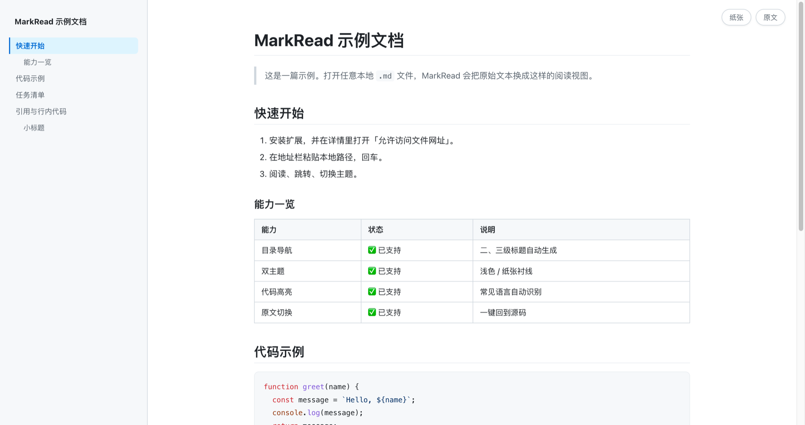
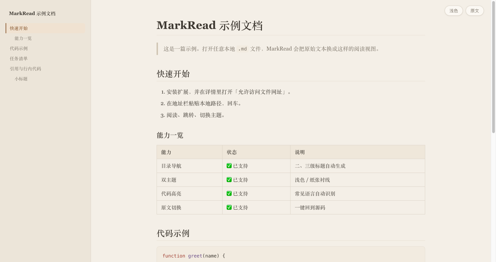

# MarkRead

> 在 Chrome 里把本地 Markdown 读成排版好的文档。全程离线，不上传任何内容。
>
> Read local Markdown files in Chrome, beautifully. 100% offline.



## 为什么做这个

Chrome 直接打开本地 `.md` 文件时只显示原始文本：`#`、`|`、反引号全部裸露，长文档很难读。MarkRead 在页面加载后把原始文本替换成阅读视图，地址栏 URL 保持不变，刷新可重现。

## 特性

- 🗂 **目录导航** — 由二、三级标题自动生成，滚动时高亮当前小节，点击平滑跳转
- 🎨 **双主题** — 浅色（GitHub 风）与纸张暖白衬线，切换后记住选择
- 🌈 **代码高亮** — 常见语言自动识别，悬停可一键复制
- 📊 **完整 Markdown** — 表格（宽表横向滚动）、引用、任务清单、图片、链接、行内代码
- 📄 **原文切换** — 随时切回原始文本，再切回渲染视图
- 🔒 **纯本地** — marked + DOMPurify 本地解析与消毒，不发网络请求
- ⚡ **零构建** — 加载已解压目录即可使用

## 安装

1. 克隆仓库并用 Chrome 打开扩展管理页：

   ```bash
   git clone https://github.com/LuckRain7/MarkRead.git
   ```

   地址栏访问 `chrome://extensions`。

2. 打开右上角「开发者模式」。

3. 点「加载已解压的扩展程序」，选择仓库根目录。

4. 在扩展卡片上点「详情」，打开 **「允许访问文件网址」**。

   > 这一项不开，扩展在本地文件上不会生效，打开 `.md` 仍然只有纯文本。

## 使用

在地址栏粘贴任意本地 Markdown 文件路径，回车：

```
/Users/you/Documents/notes.md
```

- 左上角目录跟随滚动高亮，点击跳转。
- 右上角「纸张 / 浅色」切换主题，「原文」切回源码。
- 代码块悬停右上角出现复制按钮。

## 纸张主题



## 工作原理

- 一个 Manifest V3 content script，仅匹配 `file:///*`，检测到 `.md` / `.markdown` 后缀后接管页面。
- 用 [marked](https://github.com/markedjs/marked) 解析 Markdown，[DOMPurify](https://github.com/cure53/DOMPurify) 消毒 HTML（嵌入的 `<script>` 会被移除）。
- 用 [highlight.js](https://highlightjs.org/) 做代码高亮。
- 主题选择存在 `chrome.storage.local`，下次打开仍然生效。
- 所有依赖都以浏览器版文件打包在 `vendor/` 中，运行时零网络请求。

## 开发

```bash
npm install      # 安装 marked / DOMPurify / highlight.js / jsdom
npm run vendor   # 把浏览器版依赖同步到 vendor/
npm test         # 运行单元测试（node:test + jsdom）
```

修改源码后，在 `chrome://extensions` 点扩展卡片上的刷新按钮，再刷新文档页。

### 项目结构

```
manifest.json          MV3 清单，只注入 file:// 页面
src/content.js         入口：判断 .md、注入样式、启动渲染
src/lib/md-core.js     解析、frontmatter、标题 id、目录、标题提取
src/page.js            页面骨架、主题、原文切换、滚动高亮、复制按钮
src/styles.css         双主题与正文排版
vendor/                marked / DOMPurify / highlight.js 浏览器版
scripts/vendor.sh      从 node_modules 复制依赖
test/                  node:test + jsdom 单元测试
docs/demo.md           截图用的示例文档
```

## 已知限制

- 只处理 `file://` 下的 `.md` / `.markdown`；网页上的 Markdown 链接不处理。
- mermaid 流程图暂按普通代码块显示。
- 首次使用必须在扩展详情里手动打开「允许访问文件网址」。

## 常见问题

**打开 `.md` 还是纯文本？**
检查扩展详情里的「允许访问文件网址」是否已打开，然后刷新页面。

**改了代码不生效？**
先在 `chrome://extensions` 刷新扩展，再刷新文档页。

**会泄露文档内容吗？**
不会。解析与渲染全部在本地完成，代码中没有任何网络请求。

## English

MarkRead renders local Markdown files opened in Chrome (`file://`) into a clean reading view: sidebar table of contents, light / paper themes, syntax highlighting, and a one-click raw-source toggle. Parsing happens entirely offline. Load the folder as an unpacked extension and enable **"Allow access to file URLs"** in its details page.

## License

[MIT](LICENSE) © 2026 nc_rain